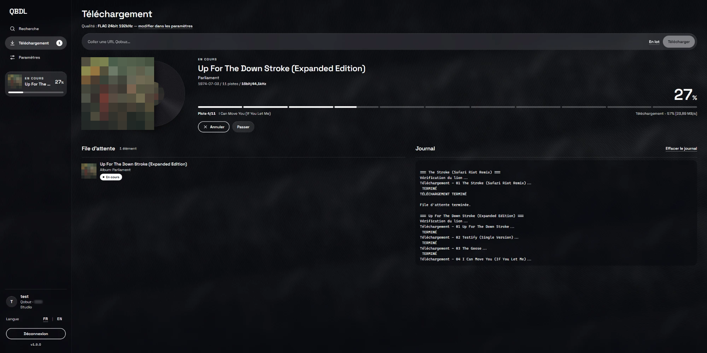
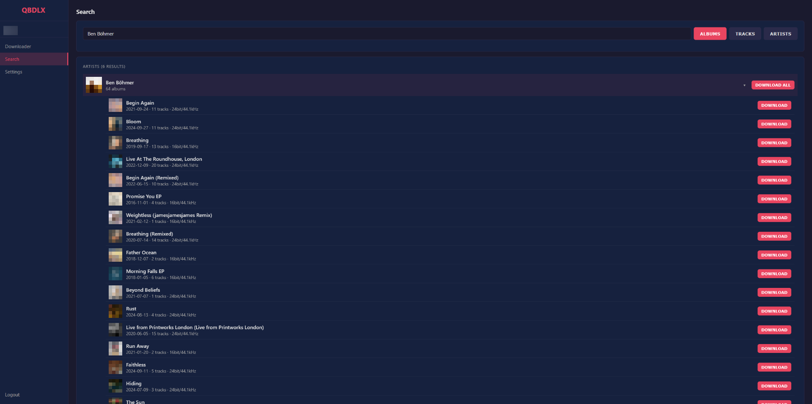
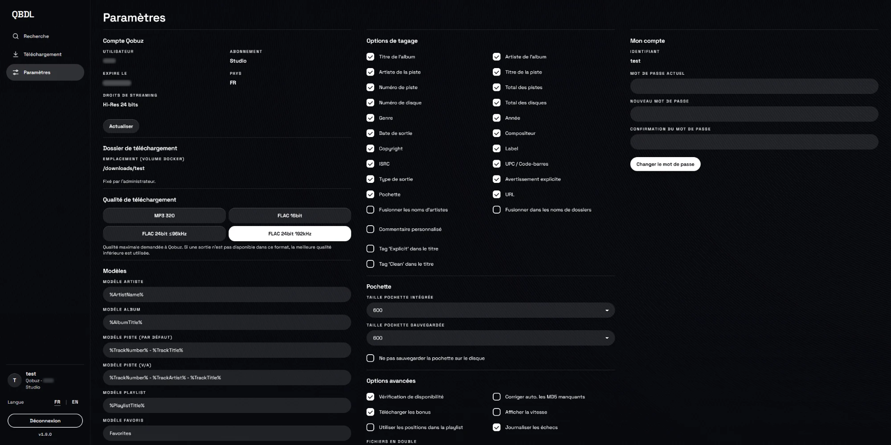
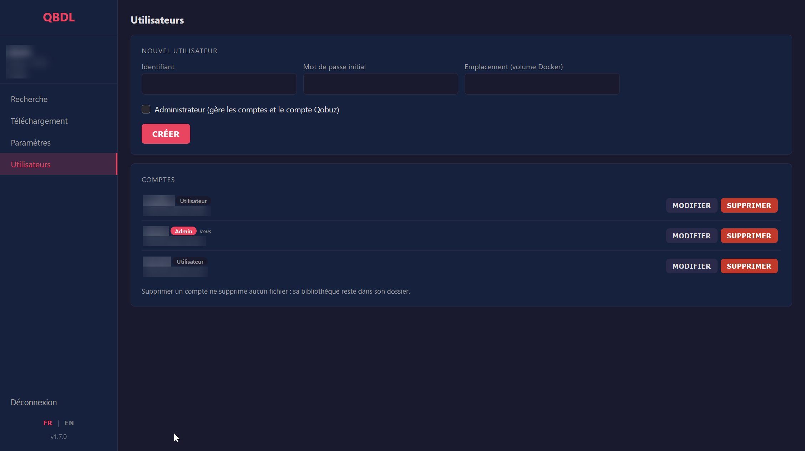

# QBDL.Web

A self-hosted web application for downloading high-quality music from Qobuz. Built with Blazor Server (.NET 8) and designed to run in Docker.

[](https://github.com/Corrosive35/QBDL.Web)
[](https://hub.docker.com/r/thimble9057/qobuzdlx.web)
[](https://hub.docker.com/r/thimble9057/qobuzdlx.web)
[](https://github.com/Corrosive35/QBDL.Remote)

[](LICENSE)

---

## Features

- **Web-based UI** — Dark theme, responsive, accessible from any browser
- **Android app** — A WebView shell that points at your own server
  ([QBDL.Remote](https://github.com/Corrosive35/QBDL.Remote)), plus an installable PWA if
  you prefer the browser
- **Multiple download types** — Albums, tracks, playlists, artists, labels, favorites
- **User accounts** — Administrator-managed accounts sharing a single Qobuz subscription; each user
  has their own download folder, quality, templates, tagging options, language and download queue
- **Parallel downloads** — Every user downloads at the same time, without waiting for the others
- **Bilingual UI** — French and English, chosen per user, browser language used until a choice is made
- **Search** — Search Qobuz by albums, tracks, or artists directly from the UI, with sorting by
  title, artist, release date, quality or track count
- **Batch downloads** — Paste multiple URLs and download them all at once
- **4 quality levels** — MP3 320, FLAC 16-bit, FLAC 24-bit (up to 96kHz), FLAC 24-bit (up to 192kHz)
- **Full metadata tagging** — ID3v2.4 (MP3) and Vorbis Comments (FLAC) with 25+ configurable tags
- **Customizable file/folder naming** — 60+ template variables for artist, album, track naming
- **Artwork** — Embedded cover art + saved to disk, configurable sizes
- **Goodies** — Downloads bonus materials (booklets, etc.) when available
- **FLAC MD5 fix** — Optional automatic MD5 checksum repair
- **Real-time progress** — Live progress bar, download speed, and log output
- **Account status** — Subscription tier, expiry date and streaming rights shown in Settings (works
  with token login too); downloads stop with a clear message instead of failing track by track when
  the subscription has lapsed
- **Persistent settings** — All configuration saved to JSON, survives restarts
- **Sign-in** — Username and password per account; a sign-in lasts 30 days per device and survives
  container restarts
- **Docker-ready** — Multi-stage Alpine image, lightweight and portable

---

## Screenshots

| Downloader | Search |
|:---:|:---:|
|  |  |
| **Settings** | **Users** |
|  |  |

---

## Quick Start (Docker)

### Using Docker Run

```bash
docker run -d \
  --name qobuzdlx \
  -p 8080:8080 \
  -v /path/to/downloads:/downloads \
  -v /path/to/config:/config \
  --restart unless-stopped \
  thimble9057/qobuzdlx.web
```

### Using Docker Compose

Create a `docker-compose.yml`:

```yaml
services:
  qobuzdlx:
    image: thimble9057/qobuzdlx.web
    container_name: qobuzdlx
    ports:
      - "8080:8080"
    volumes:
      - /path/to/downloads:/downloads
      - /path/to/config:/config
    restart: unless-stopped
```

Then run:

```bash
docker-compose up -d
```

Open your browser at **http://localhost:8080**

---

## Volumes

| Path | Description |
|------|-------------|
| `/downloads` | Where downloaded music files are saved |
| `/config` | Persistent configuration: `settings.json` (shared Qobuz account) and `users.json` (accounts and their settings) |

### File permissions

The application never runs as root. By default it runs as **UID 1000** and **GID 1000**; set
`PUID` and `PGID` to choose another user, for example `-e PUID=99 -e PGID=100` (`nobody:users`)
on Unraid.

At startup, the container takes over `/config` (recursively) and the `/downloads` folder itself
(never its contents) when that user cannot write to them, for instance a folder Docker has just
created as root. If it cannot, it stops and prints the `chown` command to run on the host. When
an existing installation switches to another user (from 1000 to 99:100, for example), what the
previous user owned in `/downloads` is handed over once, permissions unchanged. A container
started with `--user` runs as that user and ignores `PUID` and `PGID`.

---

## Configuration

### Accounts

On a fresh install, the first visit asks you to **create the administrator account**. Administrators
then manage the other accounts from the **Users** page: create, rename, change role, reset password,
set the download folder (`/downloads/<username>` by default) or delete. Deleting an account never
deletes its files.

- **Download folder** — Set by an administrator only, read-only for the user. It must be an absolute
  path and cannot be `/` or inside `/config`.
- **Settings** — Quality, templates, tagging, artwork and advanced options belong to each user.
- **Queue** — Each user only sees and controls their own queue and log. Users download in parallel;
  within one queue, items are processed one at a time, in order.
- **Language** — Each user's choice is saved on their account.
- **Password** — Each user changes their own from Settings → *My account*. Changing it signs out the
  user's other devices, not anyone else's.

**Upgrading from 1.6 or earlier** is automatic. If an access password was set, it becomes the
password of an administrator account named **`admin`**, which keeps your existing settings, folder
and language. Without one, the first visit shows the *create administrator* screen, and the account
you create inherits those settings. A copy of the previous configuration is kept as
`settings.json.pre-1.7.0.bak`. Every device has to sign in once after the upgrade.

### Login

Only an administrator can connect or disconnect the Qobuz account, which every user then shares.
Until it is connected, other users see a waiting message. You can connect with:

- **Sign in with Qobuz** — Opens the Qobuz sign-in page; you sign in there and come back connected.
  QBDL never sees your password. Qobuz sends the browser back to the address QBDL is opened with,
  so there is nothing to configure. In the Android app, the page opens in the phone's browser.
- **Token** — Paste an existing user auth token, under *Sign in with token*

Qobuz no longer accepts email and password sign-in from third-party apps, so that option is gone.

The app automatically retrieves the required `app_id` and `app_secret` from the Qobuz web player.
For a token, you can also provide custom values under *Custom App ID / Secret*.

A token is only accepted with the `app_id` it was issued for. If Qobuz rejects it — invalid, expired
or issued for another application, the response does not tell which — use *Sign in with Qobuz*,
copy a token from play.qobuz.com, or enter the App ID and App Secret of the application that issued
it under *Custom App ID / Secret*. Login failures are logged as warnings (`docker logs`), never with
the token, secret or password.

### Quality

Select your preferred audio quality from the settings page:

| Option | Format | Quality ID |
|--------|--------|------------|
| MP3 320 | `.mp3` | 5 |
| FLAC 16-bit | `.flac` | 6 |
| FLAC 24-bit ≤96kHz | `.flac` | 7 |
| FLAC 24-bit 192kHz | `.flac` | 27 |

### Templates

Customize your folder and file structure using template variables. Default structure:

```
/downloads/{ArtistName}/{AlbumTitle}/{TrackNumber} - {TrackTitle}.flac
```

Available templates:

| Template | Default | Description |
|----------|---------|-------------|
| Artist | `%ArtistName%` | Artist folder name |
| Album | `%AlbumTitle%` | Album folder name |
| Track | `%TrackNumber% - %TrackTitle%` | Track filename |
| VA Track | `%TrackNumber% - %TrackArtist% - %TrackTitle%` | Track filename for compilations |
| Playlist | `%PlaylistTitle%` | Playlist folder name |
| Favorites | `Favorites` | Favorites folder name |
| CD | `CD %DiscNumber%` | Multi-disc subfolder |

<details>
<summary><strong>All template variables</strong></summary>

**Release-specific:**
`%AlbumID%`, `%AlbumURL%`, `%AlbumTitle%`, `%AlbumGenre%`, `%AlbumComposer%`, `%Label%`, `%Copyright%`, `%UPC%`, `%ReleaseDate%`, `%Year%`, `%ReleaseType%`, `%ArtistName%`, `%Format%`, `%FormatWithQuality%`, `%FormatWithHiResQuality%`, `%BitDepth%`, `%SampleRate%`

**Track-specific:**
`%TrackID%`, `%TrackNumber%`, `%TrackTitle%`, `%TrackArtist%`, `%TrackComposer%`, `%ISRC%`, `%TrackFormat%`, `%TrackFormatWithQuality%`, `%TrackFormatWithHiResQuality%`, `%TrackBitDepth%`, `%TrackSampleRate%`

**Playlist-specific:**
`%PlaylistID%`, `%PlaylistTitle%`

**Disc-specific:**
`%DiscNumber%`

**Parental advisory:**
`%TrackPA%`, `%TrackPAShort%`, `%TrackPAifEx%`, `%TrackPAEnclosed%`, `%AlbumPA%`, `%AlbumPAShort%`, `%AlbumPAifEx%`, `%AlbumPAEnclosed%` *(and more variants)*

</details>

### Tagging

Toggle individual metadata tags from the Settings page:

Album, Album Artist, Artist, Title, Track Number, Total Tracks, Disc Number, Total Discs, Genre, Year, Release Date, Composer, Copyright, Label, ISRC, UPC, Type, Explicit, Cover Art, URL, Custom Comment

Additional tagging options:
- Merge multiple artist names
- Add Explicit/Clean tags to track titles
- Custom comment text with `%description%` placeholder

### Artwork

| Setting | Default | Description |
|---------|---------|-------------|
| Embedded art size | 600px | Size of cover art embedded in audio files |
| Saved art size | 600px | Size of `cover.jpg` saved to disk |
| Save to disk | Enabled | Save a separate `cover.jpg` file |

### Advanced

| Setting | Default | Description |
|---------|---------|-------------|
| Streamable check | Enabled | Skip non-streamable tracks |
| Fix MD5s | Disabled | Repair FLAC MD5 checksums (requires `flac` CLI) |
| Download goodies | Enabled | Download booklets and bonus materials |
| Print speed | Disabled | Show download speed in logs |
| Duplicate handling | Skip | `skip`, `rename`, or `overwrite` existing files |
| Log failed downloads | Enabled | Log errors to output |

---

## Supported URL Types

| Type | URL Pattern | Action |
|------|-------------|--------|
| Album | `https://play.qobuz.com/album/{id}` | Downloads all tracks |
| Track | `https://play.qobuz.com/track/{id}` | Downloads single track |
| Playlist | `https://play.qobuz.com/playlist/{id}` | Downloads all playlist tracks |
| Artist | `https://play.qobuz.com/artist/{id}` | Downloads full discography |
| Label | `https://play.qobuz.com/label/{id}` | Downloads all label releases |
| Favorites | `https://play.qobuz.com/user/{id}/albums` | Downloads favorite albums |
| Favorites | `https://play.qobuz.com/user/{id}/tracks` | Downloads favorite tracks |
| Favorites | `https://play.qobuz.com/user/{id}/artists` | Downloads favorite artists |

Qobuz store links (e.g. `https://www.qobuz.com/fr-fr/album/...`) are also supported and automatically converted.

---

## Android

Two ways to get the app on your phone, both pointing at your own server.

**Install from the browser.** Open your instance in Chrome and pick *Add to home screen*. You get
the icon and a window without an address bar. Nothing to build.

**Or install the APK.** [QBDL.Remote](https://github.com/Corrosive35/QBDL.Remote) is a
separate project: a small WebView shell around the same interface, so there is no second UI to
maintain. It adds what a browser tab cannot do: the server address is remembered,
rotating the phone no longer reloads the page, and the app recovers on its own after a spell in
the background.

The setup screen accepts `192.168.1.42`, `qobuz.mydomain.com` or a full URL, tries HTTPS then HTTP
(with and without port 8080), and only saves an address once `/healthz` has answered. Since 1.7.0,
the server requires QBDL.Remote **1.1.2 or later**: `/healthz` now reports `QBDL.Web`, and earlier
versions reject the address during setup. An app that is already set up keeps working. The signed
APK is on its [Releases](https://github.com/Corrosive35/QBDL.Remote/releases) page, and the app
shows up on the phone as **QobuzDL**;
[build instructions](https://github.com/Corrosive35/QBDL.Remote#compiler-depuis-les-sources) are
in its own `README.md`.

> **Reverse proxy:** make sure WebSockets are proxied. Without them SignalR silently falls back to
> long polling — the app still works, but every click gains 300–800 ms and the battery drains.
> Check for a `101 Switching Protocols` on `/_blazor` in DevTools › Network.

---

## Build from Source

### Prerequisites

- [.NET 8 SDK](https://dotnet.microsoft.com/download/dotnet/8.0)

### Run locally

```bash
cd QBDL.Web
dotnet run
```

The app will be available at `http://localhost:8080`.

### Build Docker image

```bash
cd QBDL.Web
docker build -t thimble9057/qobuzdlx.web .
```

---

## Tech Stack

| Component | Technology |
|-----------|------------|
| Framework | Blazor Server (.NET 8) |
| Runtime | ASP.NET Core Kestrel |
| Audio tagging | TagLibSharp 2.3.0 |
| JSON | Newtonsoft.Json 13.0.3 |
| Container | Alpine Linux (multi-stage build) |
| FLAC tools | `flac` CLI (installed in container) |

---

## Project Structure

```
QBDL.Web/
├── Pages/
│   ├── Login.razor          # Qobuz account connection (administrators)
│   ├── Downloader.razor     # Download queue, progress and log
│   ├── Search.razor         # Search albums, tracks, artists (home page)
│   ├── Settings.razor       # Per-user settings, shared Qobuz account, own password
│   └── Users.razor          # Account management (administrators)
├── Shared/
│   └── MainLayout.razor     # Sidebar, sign-in and first-run screens
├── Models/
│   ├── AppSettings.cs       # Shared Qobuz account
│   ├── UserAccount.cs       # An application account
│   ├── UserSettings.cs      # Per-user download settings (60+ properties)
│   └── QobuzModels.cs       # Qobuz API response models
├── Services/
│   ├── QobuzApiService.cs   # Qobuz API client
│   ├── QobuzSignInService.cs # Qobuz account connection (Sign in with Qobuz, token)
│   ├── DownloadService.cs   # Core download engine, one queue per user
│   ├── SettingsService.cs   # settings.json
│   ├── UserStore.cs         # users.json, account rules, upgrade from 1.6
│   ├── TemplateService.cs   # Path/filename templating
│   ├── TaggingService.cs    # ID3v2 & Vorbis tagging
│   ├── LocalizationService.cs # FR/EN catalogues, per-request language
│   ├── SearchStateStore.cs  # Last search, per user
│   ├── AppGuardService.cs   # Current user, password hashing
│   └── AppAccessGate.cs     # App-wide sign-in throttling
├── wwwroot/css/app.css      # Dark theme styles
├── Program.cs               # App entry point
├── Dockerfile               # Multi-stage Docker build
└── docker-compose.yml       # Compose configuration
```

---

## Requirements

- A valid **Qobuz account** (subscription required for Hi-Res streaming)
- Docker (recommended) or .NET 8 runtime

---

## Avertissement

**Projet personnel et non officiel.** Il n'a aucun lien avec Qobuz : il n'est ni affilié, ni
approuvé, ni soutenu, ni sponsorisé par Qobuz ou par son propriétaire. « Qobuz » est une marque de
son titulaire, employée ici à titre purement descriptif. Toutes les marques citées appartiennent à
leurs titulaires respectifs.

**Ce que contient ce dépôt.** Le code source d'un serveur que l'utilisateur héberge et administre
lui-même, et qui ne fonctionne qu'avec **son propre compte Qobuz** — un abonnement en cours est
nécessaire pour télécharger. Ce dépôt ne contient :

- aucun identifiant, jeton, clé ou secret d'application ;
- aucun contenu protégé : ni musique, ni pochette, ni logo ou élément graphique d'un tiers.

**Responsabilité de l'utilisateur.** Chacun est seul responsable de l'usage qu'il fait de ce
logiciel. Il lui appartient de respecter les conditions d'utilisation des services tiers concernés,
ainsi que la législation sur le droit d'auteur en vigueur dans son pays. Les auteurs n'encouragent
ni ne cautionnent aucun usage qui y contreviendrait, et déclinent toute responsabilité à cet égard.
Le logiciel est fourni « tel quel », sans garantie d'aucune sorte (voir [LICENSE](LICENSE)).

**Titulaires de droits.** Si vous estimez qu'un élément de ce dépôt porte atteinte à vos droits,
ouvrez une [issue](https://github.com/Corrosive35/QBDL.Web/issues) : la demande sera examinée, et
l'élément retiré promptement s'il y a lieu.

## Disclaimer

**Unofficial personal project.** It is not affiliated with, endorsed, supported or sponsored by
Qobuz or its owner. "Qobuz" is a trademark of its respective owner and is used here for
descriptive purposes only. All trademarks mentioned belong to their respective owners.

**What this repository contains.** The source code of a server that users host and run
themselves, and that only works with **their own Qobuz account** — an active subscription is
required to download. This repository contains:

- no credentials, tokens, keys or application secrets;
- no copyrighted content: no music, artwork, or third-party logos or graphics.

**User responsibility.** Users are solely responsible for how they use this software, and must
comply with the terms of service of any third-party service involved and with the copyright laws
of their country. The authors do not encourage or condone any use that would violate them, and
disclaim all liability in that regard. The software is provided "as is", without warranty of any
kind (see [LICENSE](LICENSE)).

**Rights holders.** If you believe anything in this repository infringes your rights, please
open an [issue](https://github.com/Corrosive35/QBDL.Web/issues); the request will be reviewed,
and the material promptly removed where appropriate.
